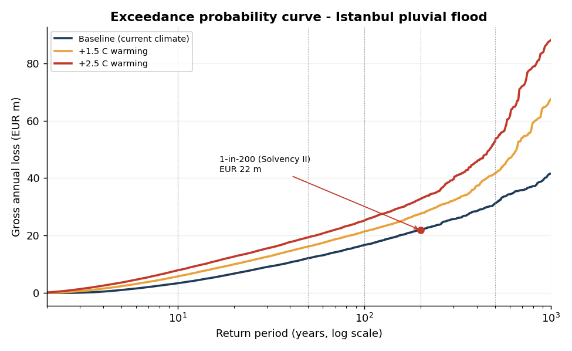
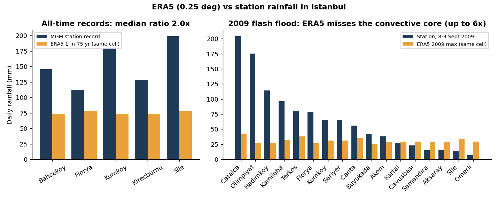
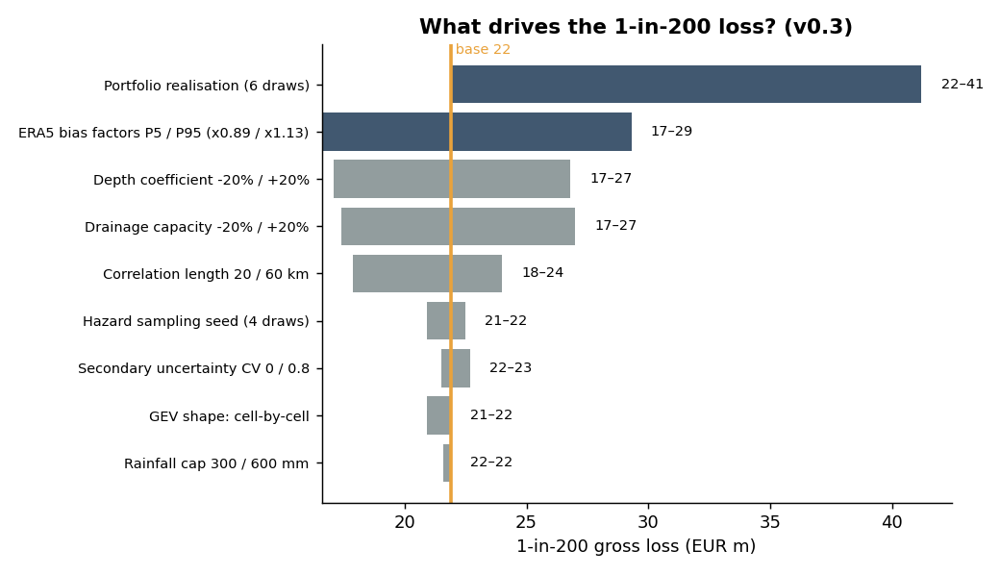
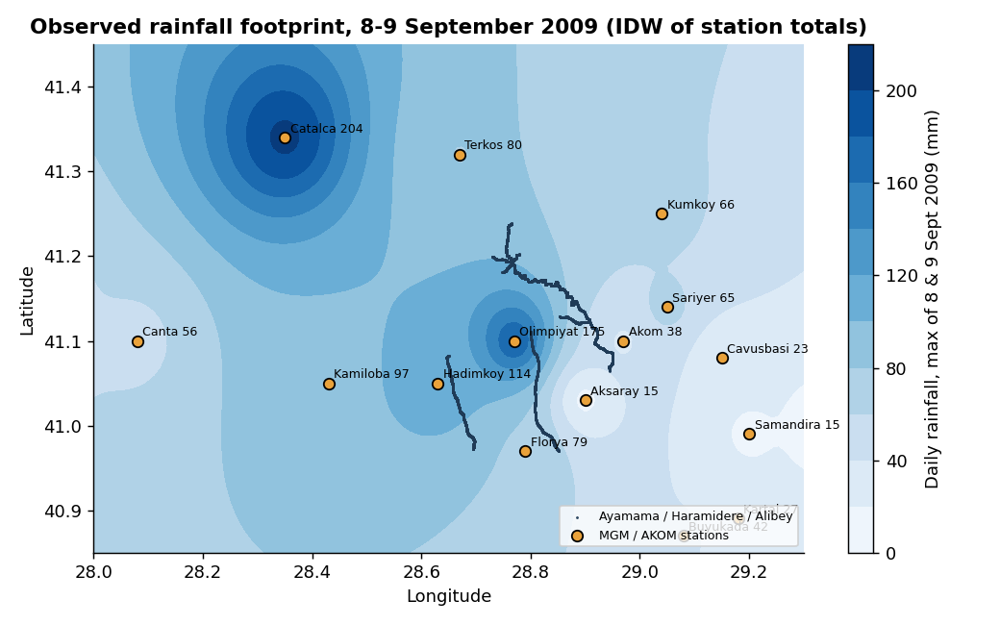
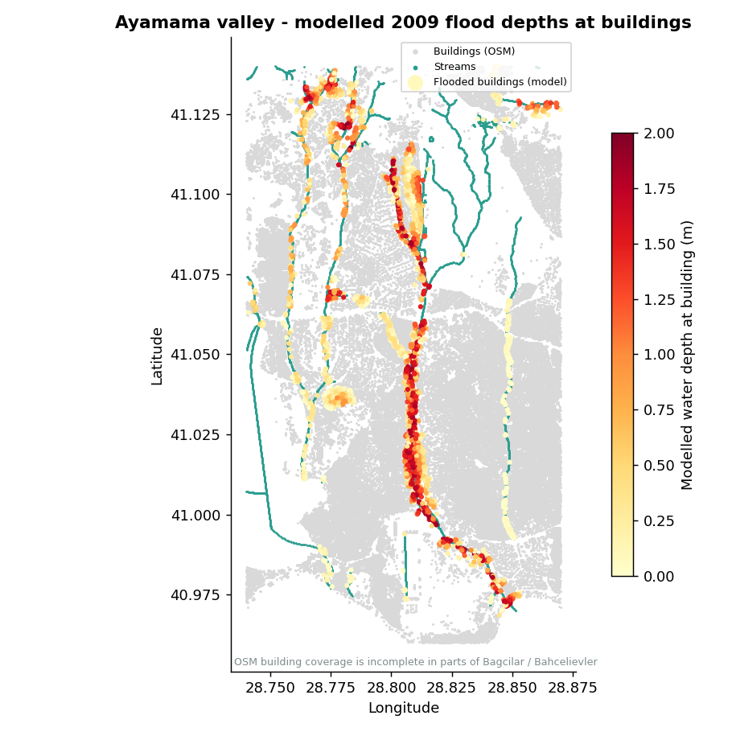
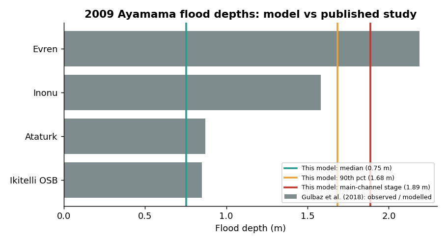
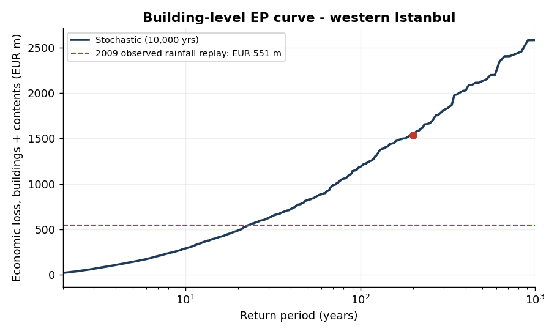
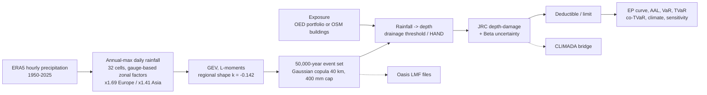

# Istanbul Pluvial Flood Catastrophe Model
### Hazard → Exposure → Vulnerability → Financial loss | EP curve · AAL · 1-in-200 (Solvency II) · uncertainty

An open, end-to-end **probabilistic catastrophe model for flash/pluvial flood in Istanbul**, built the way insurers and reinsurers structure cat models, validated against the **8–9 September 2009 flash flood**, and reviewed for model risk. It runs on a laptop with NumPy, pandas and Matplotlib, and exports **Oasis LMF** files and a **CLIMADA** bridge.

📄 **Paper:** [`docs/paper.md`](docs/paper.md) · [PDF](docs/paper.pdf). It covers the method, results, uncertainty analysis, a validation scorecard and recommendations.

---

> **v0.3 (22 Nov 2026): review revision.** Following an expert review, the ERA5 correction, the storm footprint, the validation and the uncertainty treatment were redone with official open data. Headline numbers changed. See [`CHANGELOG.md`](CHANGELOG.md) for what changed, when and why.

**What this model is:** a research prototype and scenario tool whose results are very sensitive to assumptions. The losses below belong to an **illustrative EUR 5 bn portfolio**, not to Istanbul as a whole. It is not a pricing or internal-model tool.

## Interactive risk simulator

**[Open the live simulator](https://cyamanlar.github.io/istanbul-flood-cat-model/simulator/)** (Turkish and English) — an interactive dashboard that re-runs the cat model (10,000 simulated years) in the browser as you move the levers:

| Lever group | Levers |
|---|---|
| Climate | global warming (0–4 °C), rainfall scaling per °C (5–14 %, a stress test) |
| Hazard data | ERA5 correction multiplier (×0.6–1.4 around the gauge-based factors), storm footprint size (15–120 km) |
| Adaptation & land use | drainage capacity in flood-prone zones, floodplain development, raised ground floors |
| Insurance terms | deductible (0–5 % of TIV) |

It shows AAL, the 1-in-200 (Solvency II) loss, TVaR 99.5 %, a 2009-style event loss, the EP curve with the P5–P95 band of the ERA5 correction, and the AAL by district. Under this model's assumptions, +2.5 °C (at 7 %/°C) roughly doubles the AAL of the example portfolio; the same warming with drainage at 100 mm/day and floors raised 0.3 m brings it about 75 % below today's level. Doubling the share of values in flood-prone zones raises the 1-in-200 loss more than +2.5 °C does.

The page (`docs/simulator/index.html`) is self-contained and also opens locally by double-click. Its data is built by `scripts/build_simulator_data.py`. The browser engine uses the mean damage ratio, one portfolio and 10,000 years, so its numbers differ from the full Python model.

## Why this matters

Istanbul is a city of about 16 million people on steep coastal terrain. Short convective storms overwhelm drainage within an hour. On 9 September 2009 the Ayamama stream flooded İkitelli and the districts downstream; a gauge-driven hydrological model put the peak above the 500-year flood (Yucel, 2015). On 14 October 2026 up to 273 mm fell around the Bosphorus and the northern districts, with 1,277 flooding reports in one day. Flood sits in private property books, and Solvency II calibrates capital to the 1-in-200-year loss. EIOPA also asks insurers to test climate scenarios in the ORSA.

## Key results (v0.3)

Illustrative EUR 5 bn property portfolio. All losses are **insured losses of this portfolio, net of a 1 % deductible per location** (called "gross" in insurance terms: before reinsurance); they are not economic losses for the city. The **central estimate and 90 % range** come from 40 runs that vary every uncertain assumption (ERA5 correction, storm footprint, rainfall–depth transfer, drainage threshold, portfolio realisation; `scripts/epistemic_uncertainty.py`). The **reference run** is one fixed portfolio and 50,000 years, used for the EP curve and the figures.

| Metric | Central (P50) | 90 % range (P5–P95) | Reference run | Monte Carlo error (±, 90 %) |
|---|---:|---:|---:|---:|
| **AAL** (EUR m) | **1.6** | 0.9–3.9 | 1.19 | 0.03 |
| **1-in-200 loss, VaR 99.5 %** (EUR m) | **34** | 24–49 | 21.9 | 0.8 |
| TVaR 99.5 % (EUR m) | 53 | 40–77 | 39.8 | 3.4 |

The model uncertainty (range) is about 30 times wider than the sampling error of 50,000 years. More simulated years do not make the answer more certain; better data does.

Reference-run EP curve: 1-in-10 3.4, 1-in-50 12.1, 1-in-100 16.7, 1-in-200 21.9, 1-in-500 30.9 EUR m. A 2009-style storm costs 35.5 EUR m (about 1-in-680 years on the reference curve).

**Climate stress test.** Under this model's assumption of +7 % rainfall per °C, the AAL of the example portfolio rises 61 % at +1.5 °C and 119 % at +2.5 °C; the 1-in-200 loss rises 26 % and 49 %. This is a sensitivity test, not a projection for Istanbul (see roadmap).



### Finding 1: ERA5 misses where convective storms fall; its long-run bias is smaller and differs by side of the Bosphorus

* **Single storm days.** Against MGM hourly gauges for 8–9 September 2009, the gauge/ERA5 ratio over the same 48 hours ranges from **1.5 to 6.3 on the European side** and falls **below 1 on the Asian side** (Şile 0.47, Gebze 0.09) (`scripts/era5_vs_mgm_2009.py`). On the AKOM gauges the event-day ratio reaches ×9.8 at Olimpiyat (`scripts/era5_event_check.py`). ERA5 places the convective core in the wrong location rather than scaling it down uniformly.
* **Long-run statistics.** Over the same years (2011–2023), the mean annual maximum daily rainfall at seven IBB water-supply dam gauges is **1.69× ERA5 on the European side** (90 % CI 1.51–1.90) and **1.41× on the Asian side** (1.22–1.64) (`scripts/bias_matched_period.py`). v0.3 uses these zonal factors instead of the single v0.2 factor of 1.8, with their uncertainty.
* **Independence.** The v0.2 check used 5 MGM records that sit in only **3 independent ERA5 cells**; the v0.3 matched-period check uses 7 gauges in 6 cells over 91 station-years.



### Extreme-value checks

On raw ERA5 1950–2025 (`scripts/extreme_value_diagnostics.py`): the 90 % confidence interval of the GEV 100-year daily rainfall is about **±15 %** per cell (bootstrap, 12–20 %); a **Mann-Kendall test finds no trend** in the annual maxima (2 of 32 cells significant at 5 %, about the false-positive rate; regional mean p = 0.38), unlike the rising station extremes reported for Istanbul, which ERA5 may smooth out; a **peaks-over-threshold GPD fit** gives 100-year levels within −15 % to +12 % of the GEV (median ratio 0.98).

### Finding 2: storms are smaller than the v0.2 footprint assumed

The 2009 storm in the MGM Istanbul radar has a spatial e-folding distance of about **22 km** (`scripts/radar_2009_footprint.py`). Daily rainfall at the dam gauges decorrelates over about **51 km**, and their annual maxima over about **34 km**. v0.3 uses **40 km** (v0.2: 60 km) and tests 20–60 km.

### Finding 3: drainage, the ERA5 correction and the portfolio drive the uncertainty

| Assumption varied (reference run) | 1-in-200 loss (EUR m) |
|---|---|
| ERA5 correction P5 / P95 | 16.6 / 29.3 |
| Portfolio realisation, 6 draws | 21.9–41.2 |
| Drainage capacity +20 % / −20 % | 17.4 / 27.0 |
| Depth coefficient −20 % / +20 % | 17.1 / 26.8 |
| Correlation length 20 / 60 km | 17.9 / 24.0 |
| Hazard sampling, 4 seeds | 20.9–22.5 |

In the 40-run ensemble, the drainage threshold (rank correlation −0.52), the ERA5 correction (0.49) and the footprint size (0.45) explain most of the spread of the 1-in-200 loss.



### Finding 4: OpenStreetMap misses about two thirds of the buildings in the Ayamama basin

Inside the Ayamama validation box, OSM holds 32,584 buildings and Microsoft's Global ML Building Footprints (ODbL) 93,768. v0.3 adds the 68,159 footprints that do not overlap OSM (`scripts/gapfill_buildings_ms.py`). Before the gap fill, three of the five 2009 survey locations had **no buildings within 1 km** in the model.

### Finding 5: the 2009 replay gets the size and the downstream trend, not the local detail

The building-level module now covers 145,978 buildings. The replay gives an Ayamama main-channel stage of 1.89 m. Point by point, at four 2009 survey locations (Gülbaz et al., 2019), the median modelled depth of flooded buildings within 1 km is 0.89, 0.38, 1.25 and 1.46 m against observed 0.85, 0.87, 1.58 and 2.19 m: **MAE 0.40 m, bias −0.38 m**. The model reproduces the downstream increase but not the 13.75 m backwater at the Çobançeşme culvert, which needs hydraulic modelling. The modelled event loss, **EUR 551 m** at today's replacement cost, is well above the USD 70–175 m reported in 2009; the gap points to the valuation assumptions and is discussed in the paper.

| | |
|---|---|
|  |  |
|  |  |

## Validation status (v0.3)

The model is fit for **portfolio steering and scenario analysis**. It is not yet fit for pricing individual risks or for an internal-model capital figure.

| Component | Status | Evidence |
|---|---|---|
| Rainfall frequency | Partly validated | Matched-period gauges, 7 sites in 6 cells, 2011–2023 |
| ERA5 on single events | Tested, weak | MGM hourly 2009: ratios 0.1–6.3; core misplaced |
| Spatial dependence | Partly validated | Radar 2009 (22 km), gauges (34–51 km) |
| 2009 rainfall footprint | Validated | 18 stations + MGM hourly gauges |
| Rainfall → depth | Calibrated on 2009 only | Point-wise MAE 0.40 m at 4 sites; independent event (Oct 2026) pending |
| Depth → damage | Not validated for Turkey | JRC Europe curves |
| Exposure | Illustrative portfolio; OSM gaps filled in the Ayamama basin only | Microsoft footprints |

## Data and licences

| Data | Used for | Licence / terms | In this repo |
|---|---|---|---|
| ERA5 hourly precipitation (Copernicus C3S, via CDS) | Hazard | Copernicus licence; contains modified Copernicus Climate Change Service information | Yes (`data/hazard/era5_raw`) |
| Copernicus GLO-30 DEM | HAND flood-zone index | Copernicus DEM licence | Yes (`data/raw/rasters_COP30.tar.gz`) |
| OpenStreetMap buildings and waterways | Exposure, streams | ODbL, © OpenStreetMap contributors | Yes |
| Microsoft Global ML Building Footprints (release 2026-02-03) | OSM gap fill, Ayamama basin | ODbL | Yes (`data/raw/ayamama_buildings_ms_gapfill.geojson`) |
| IBB daily dam rainfall 2011–2024; AKOM AWOS station list | ERA5 bias, footprint size | IBB Open Data Licence (data.ibb.gov.tr) | Yes (`data/ibb/`) |
| MGM hourly gauges and Istanbul radar, September 2009 | Event check, storm footprint | MGM data supplied for research; **not redistributed** | No (derived tables only) |
| JRC global depth–damage functions (Huizinga et al., 2017) | Vulnerability | JRC technical report | Values in code |
| Station values from publications (MGM records, 2009 totals) | Bias check, 2009 replay | Cited publications | Yes |
| OSM Nominatim geocoding | 2009 survey locations | ODbL | Coordinates in code |

---

## Model architecture



| Module | File | Method |
|---|---|---|
| Hazard | `src/hazard.py`, `src/gev.py` | Annual maxima → GEV per cell (L-moments, regional shape) → Gaussian-copula event set → cap and climate scaling |
| Exposure | `src/exposure.py` | 39 districts → 1,505 OED locations (illustrative) |
| Vulnerability | `src/vulnerability.py` | Rainfall–depth transfer; JRC European depth-damage curves; Beta secondary uncertainty |
| Financial and metrics | `src/financial.py` | Deductible and limit; EP, AAL, VaR, TVaR, co-TVaR |
| Building level | `src/building_level.py`, `run_building_level.py` | OSM valuation, HAND flood zones, 2009 replay |
| Oasis export | `src/oasis_export.py` | Footprint, vulnerability, bins, keys (first 10,000 years) |
| CLIMADA bridge | `scripts/climada_bridge.py` | Same event set and impact functions in CLIMADA |

## Quick start

```bash
pip install -r requirements.txt
python run_model.py                       # portfolio model, ~10 s
python run_building_level.py              # building-level model + 2009 validation, ~20 s
python scripts/era5_bias_check.py         # ERA5 vs stations (Figure 1)
python scripts/bias_matched_period.py     # v0.3 ERA5 factors from IBB dam gauges
python scripts/era5_event_check.py        # ERA5 on event days, stations per ERA5 cell
python scripts/sensitivity_uncertainty.py # one-at-a-time sensitivity runs
python scripts/epistemic_uncertainty.py   # 40-run uncertainty ensemble (~3 min)
python scripts/plot_uncertainty.py        # tornado chart
```

Scripts that need MGM data not included in the repo: `scripts/era5_vs_mgm_2009.py` (hourly gauges) and `scripts/radar_2009_footprint.py` (radar).

All assumptions are in `config.json`.

### Re-download ERA5 (optional)

The processed annual maxima (`data/hazard/era5_annual_max.csv`) and the raw hourly files (`data/hazard/era5_raw/`) are included. To rebuild them, create a free Copernicus CDS account and accept the ERA5 licence. Then run:

```bash
pip install cdsapi xarray netCDF4 dask
python scripts/download_era5.py --start 1950 --end 2025   # Windows: scripts\era5_windows.bat
python scripts/process_era5.py
```

## Repository layout

```
├── run_model.py / run_building_level.py   entry points
├── config.json                            all assumptions
├── src/                                   hazard, exposure, vulnerability, financial, building level, plots, Oasis export
├── scripts/                               ERA5 download and processing, bias check, sensitivity, CLIMADA bridge
├── data/hazard/                           ERA5 raw (NetCDF) and annual maxima, 2009 station totals, MGM records
├── data/raw/                              OSM buildings and waterways, Copernicus DEM (inputs to the building module)
├── data/exposure/                         illustrative portfolio (OED) and processed building table
├── oasis/                                 Oasis LMF model files and keys
├── outputs/                               tables and figures
└── docs/                                  paper (md, pdf), model card
```

Data sources and licences are listed in [`data/README.md`](data/README.md).

## Limitations and roadmap

* Rainfall–depth proxy instead of hydraulic routing; daily rather than hourly rainfall.
* ERA5 factors come from 7 dam gauges over 13 years; the upper quantiles (ratio about 1.8) suggest the station-scale tail is heavier than the factor-scaled ERA5 tail.
* One dominant event per year; clustering of storms within a year is not modelled.
* The climate scaling (7 %/°C) is a stress test, not a projection.
* Damage curves are not calibrated to Turkish claims; the portfolio is illustrative; the OSM gap fill covers the Ayamama basin only.

Next steps:

- [ ] Independent validation with the 13–15 October 2026 event (ERA5 via CDS, AKOM gauges, Sentinel-1 flood extent)
- [ ] Quantile mapping by season and duration with full MGM and AKOM hourly series; IDF curves for 1–24 h
- [ ] Projections from EURO-CORDEX and MGM, matched to SSP and period
- [ ] Areal reduction factor for catchment rainfall
- [ ] Catchment-level rainfall–stage calibration with WRF-Hydro or a 2D hydraulic model
- [ ] Hourly intensity in the hazard
- [ ] Oasis LMF run and CLIMADA cross-check
- [ ] Heatwave module

## Key references

Full list in the paper.

* Hersbach, H. et al. (2020). The ERA5 global reanalysis. *QJRMS* 146, 1999–2049. doi:10.1002/qj.3803
* Hosking, J.R.M., Wallis, J.R. (1997). *Regional Frequency Analysis.* Cambridge University Press. doi:10.1017/CBO9780511529443
* Huizinga, J., de Moel, H., Szewczyk, W. (2017). *Global flood depth-damage functions.* JRC, EUR 28552 EN. doi:10.2760/16510
* Gülbaz, S. et al. (2019). Flood modeling of Ayamama River watershed in Istanbul, Turkey. *J. Hydrol. Eng.* 24(1). doi:10.1061/(ASCE)HE.1943-5584.0001730
* Yucel, I. (2015). Assessment of a flash flood event using different precipitation datasets. *Natural Hazards* 79, 1889–1911. doi:10.1007/s11069-015-1938-9
* Nobre, A.D. et al. (2011). Height Above the Nearest Drainage. *J. Hydrol.* 404, 13–29. doi:10.1016/j.jhydrol.2011.03.051
* Aznar-Siguan, G., Bresch, D.N. (2019). CLIMADA v1. *GMD* 12, 3085–3097. doi:10.5194/gmd-12-3085-2019
* EIOPA (2022). Application guidance on running climate change materiality assessment and using climate change scenarios in the ORSA.

## Licence and attribution

Code: MIT. Building footprints and waterways © OpenStreetMap contributors, ODbL. The project contains modified Copernicus Climate Change Service information (ERA5) and modified Copernicus DEM data. Station rainfall values are taken from the publications cited.
