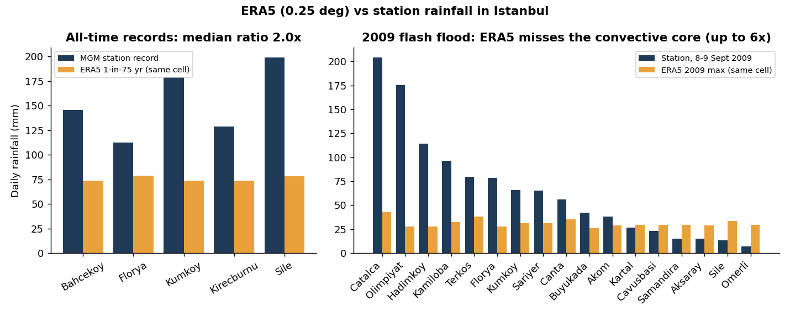
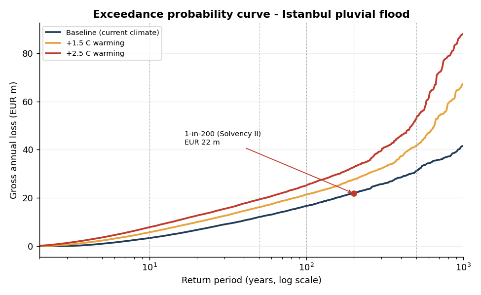
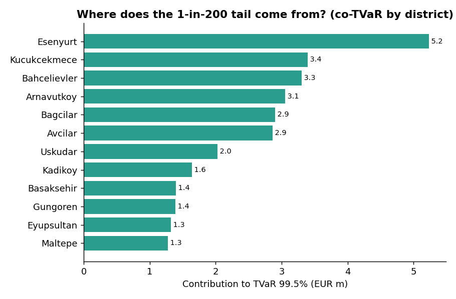
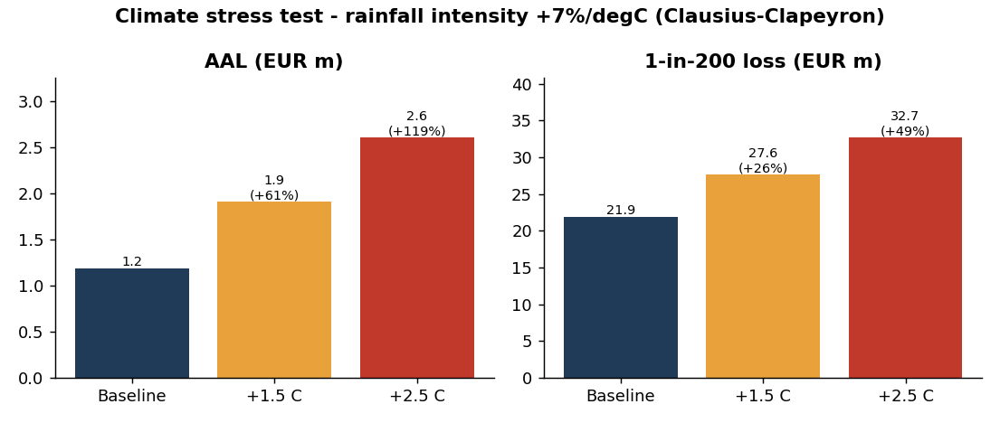
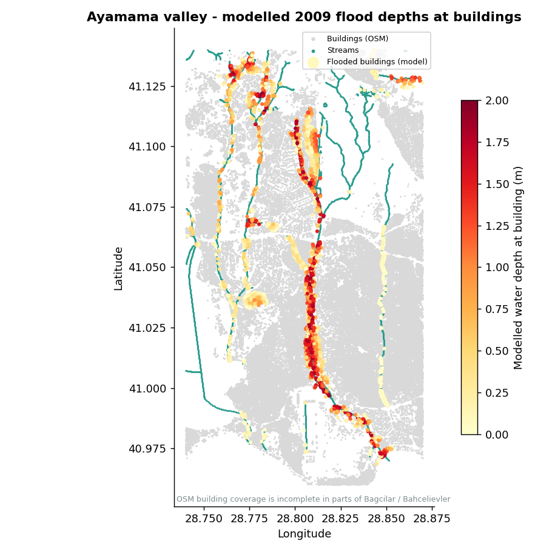
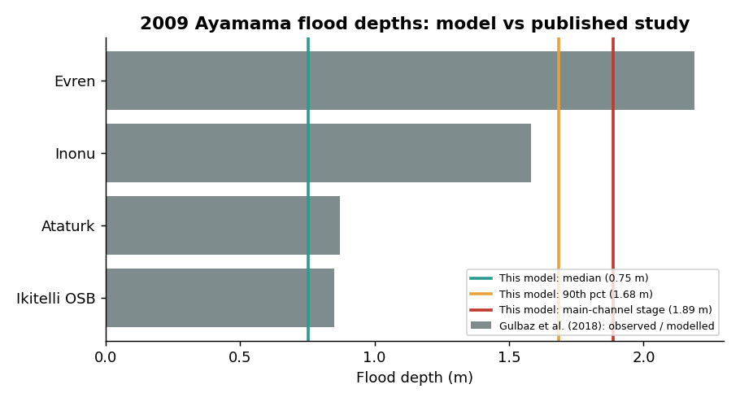
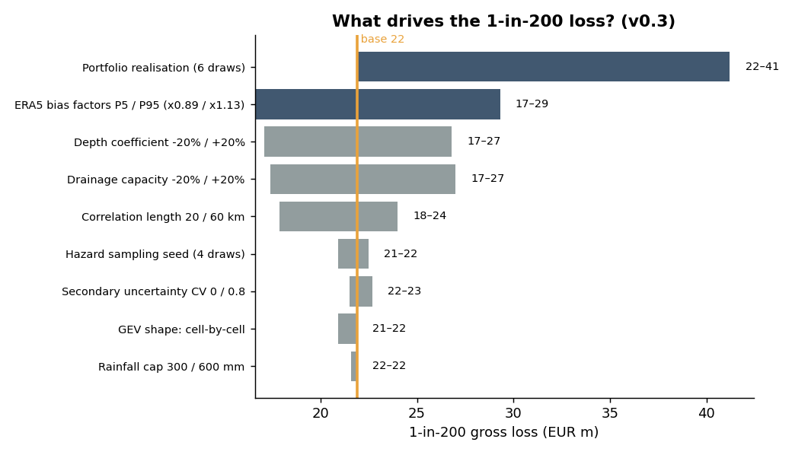

# Probabilistic Pluvial Flood Catastrophe Model for Istanbul

Working paper · November 2026 · Version 0.3 (revised 22 November 2026) · Open code and data (MIT licence)

*Subtitle:* ERA5 hazard, building-level exposure and validation against the September 2009 flash flood

## Abstract

This paper builds an open, end-to-end probabilistic catastrophe model for pluvial and flash flood in Istanbul and appraises it as a model-validation reviewer would. Its outputs are those an insurer uses: the exceedance probability (EP) curve, the average annual loss (AAL) and the 1-in-200-year loss that Solvency II uses for capital. The hazard is ERA5 annual-maximum daily rainfall for 1950–2025 (76 years, 32 grid cells at 0.25°), fitted with a generalised extreme value (GEV) distribution with a regional shape parameter, and turned into a 50,000-year stochastic event set with spatial correlation. Exposure is an illustrative EUR 5 bn property portfolio across 39 districts and, at building level, 77,819 OpenStreetMap buildings in western Istanbul. Flood zones come from a height-above-nearest-drainage (HAND) index on the 30 m Copernicus DEM, and damage from the JRC European depth-damage functions.

ERA5 misplaces Istanbul's convective storms: on 8–9 September 2009 the gauge/ERA5 ratio over the same 48 hours ranged from 1.5 to 6.3 on the European side and fell below 1 on the Asian side. Its long-run bias is smaller: over 2011–2023 the mean annual maximum daily rainfall at independent IBB dam gauges is 1.69 times ERA5 on the European side and 1.41 times on the Asian side. With these zonal factors, a 40 km correlation length taken from radar and gauges, and a 40-run ensemble over all uncertain inputs, the illustrative portfolio has a central AAL of EUR 1.6 m (90 % range 0.9–3.9 m) and a central 1-in-200 loss of EUR 34 m (24–49 m); the Monte Carlo error of 50,000 years is only ±0.8 m. Under the model's 7 %/°C assumption, +2.5 °C raises the AAL by 119 % and the 1-in-200 loss by 49 %; doubling the values in flood-prone zones raises the 1-in-200 loss more than that.

The drainage threshold, the ERA5 correction and the storm footprint dominate the uncertainty, followed by which locations lie in flood-prone zones. At building level, filling OpenStreetMap gaps with Microsoft footprints doubles the buildings in the Ayamama basin; the 2009 replay then matches the observed depths with a point-wise mean absolute error of 0.40 m but cannot represent culvert blockage. The model is a research prototype and scenario tool, not a pricing tool. The paper closes with a validation scorecard and prioritised recommendations; the v0.3 revision note below lists what changed after expert review.

**Keywords:** catastrophe modelling; flash flood; ERA5; bias correction; GEV; HAND; Solvency II; Istanbul; Ayamama

## Revision note – v0.3 (22 November 2026)

This version responds to an expert review of v0.2. The method is unchanged in structure; four inputs were re-estimated with official open data, and the results are now reported with their uncertainty. Where Sections 5–7 quote v0.2 numbers, the values below supersede them. The full list of changes is in `CHANGELOG.md`.

**What changed and why**

| Item | v0.2 | v0.3 | Evidence |
|---|---|---|---|
| ERA5 → station-scale factor | 1.8 everywhere | 1.69 European side, 1.41 Asian side, 1.55 Bosphorus column; P5–P95 ×0.89–1.13 | IBB dam gauges vs ERA5, same years 2011–2023, 7 gauges in 6 cells, 91 station-years |
| Basis of the v0.2 factor | 5 MGM all-time records; 2009 comparison | — | The 5 records sit in only 3 ERA5 cells; the 2009 comparison used the ERA5 annual maximum (31 Oct and 12 Sep 2009), not the event days |
| Spatial correlation length | 60 km | 40 km (tested 20–60 km) | MGM radar, 2009 storm: e-folding about 22 km; dam gauges: daily 51 km, annual maxima 34 km |
| Building exposure, Ayamama basin | 77,819 OSM buildings | + 68,159 Microsoft footprints with no OSM overlap | OSM held about one third of the buildings in the basin |
| 2009 validation | One stage and one depth against 5 points | Point by point; channel stage and building depth separated; 2009 labelled the calibration event | Gülbaz et al. (2019) locations geocoded with OSM Nominatim |
| Uncertainty | One-at-a-time sensitivity | 40-run ensemble of all uncertain inputs, reported separately from Monte Carlo error | `scripts/epistemic_uncertainty.py` |

**ERA5 on single storms.** Against MGM hourly gauges on 8–9 September 2009, the gauge/ERA5 ratio over the same 48 hours is 1.5–6.3 on the European side and below 1 on the Asian side (Şile 0.47, Gebze 0.09). On the AKOM gauges the event-day ratio reaches 9.8 at Olimpiyat. ERA5 places the convective core in the wrong place. This matters for event replays and for the spatial structure of the event set, but the frequency model needs the long-run ratio of distributions, which is much smaller (1.4–1.7).

**Results (illustrative EUR 5 bn portfolio, gross of a 1 % deductible)**

| Metric | Central (P50) | 90 % range | Reference run | Monte Carlo error (±, 90 %) | v0.2 |
|---|---:|---:|---:|---:|---:|
| AAL (EUR m) | 1.6 | 0.9–3.9 | 1.19 | 0.03 | 2.08 |
| 1-in-200 loss (EUR m) | 34 | 24–49 | 21.9 | 0.8 | 32.2 |
| TVaR 99.5 % (EUR m) | 53 | 40–77 | 39.8 | 3.4 | 63.7 |

The model uncertainty is about 30 times the sampling error of 50,000 years. In the ensemble, the drainage threshold, the ERA5 factor and the footprint size explain most of the spread. The central value is above the reference run because the reference portfolio is one of the least flood-exposed realisations; portfolio realisation alone moves the reference 1-in-200 loss between EUR 22 m and 41 m.

Under this model's assumption of +7 % rainfall per °C, the AAL of the example portfolio rises 61 % at +1.5 °C and 119 % at +2.5 °C, and the 1-in-200 loss 26 % and 49 %. This is a stress test, not a projection for Istanbul. In the simulator, doubling the share of values in flood-prone zones raises the 1-in-200 loss by more than +2.5 °C does: land use matters at least as much as warming.

**Building level and 2009.** With the gap fill the building module covers 145,978 buildings (EUR 160 bn). At four 2009 survey locations the median modelled depth of flooded buildings within 1 km is 0.89, 0.38, 1.25 and 1.46 m against 0.85, 0.87, 1.58 and 2.19 m observed: MAE 0.40 m, bias −0.38 m. The model reproduces the downstream increase, not the 13.75 m culvert backwater at Çobançeşme. The 2009 replay costs EUR 551 m at today's replacement cost, far above the USD 70–175 m reported in 2009; the valuation assumptions (unit costs applied to every footprint) are the most likely cause. The 2009 event is about 1-in-24 years on the building-level EP curve and about 1-in-680 years on the portfolio reference run; this gap shows how much the exposure definition and the missing areal reduction factor change the answer.

**Extreme-value checks.** The bootstrap 90 % interval of the GEV 100-year daily rainfall is about ±15 % per cell. A Mann-Kendall test finds no trend in ERA5 annual maxima (2 of 32 cells significant at 5 %; regional mean p = 0.38), unlike the rising station extremes reported for Istanbul (Şen and Aksu, 2021), which ERA5 may smooth out. A peaks-over-threshold GPD fit gives 100-year levels within −15 % to +12 % of the GEV (median ratio 0.98). Losses throughout are insured losses of the illustrative portfolio after the deductible, not economic losses.

**Independent event: October 2026.** ERA5 caught the 13–15 October 2026 storm far better than 2009: reported station totals are 1.2–3.2 times ERA5 in the same cells, and ERA5 has its largest day since 1950 in the 41.25N 28.75E cell. With the v0.3 factors the model gives this field return periods of 20–115 years by cell, and the illustrative portfolio would lose about EUR 14 m (about 1-in-70 years). The 186 mm reported for 24 hours would be a 650–770-year value at the Bosphorus cells; the wettest of dozens of gauges is rarer than a single point, but the gap also suggests the tail there is too light. ERA5 errors depend on storm type: organised systems are resolved much better than stationary convective cells.

**Still open.** Depth validation for October 2026 (AKOM gauges, Sentinel-1 flood extent); quantile mapping by season and duration with full hourly MGM and AKOM series; hydraulic routing (SWMM and HEC-RAS 2D) in Ayamama; projections from EURO-CORDEX and MGM; local damage curves.


## 1. Introduction

Istanbul's flash floods are short, local and costly, and insurers need them priced and capitalised. The city holds about 16 million people on steep coastal topography, and rapid urbanisation has sealed many small catchments. Short-duration extreme rainfall can exceed urban drainage capacity within an hour.

The benchmark event is the flood of 8–9 September 2009. Station totals reached 204 mm at Çatalca on 8 September and 175 mm at Olimpiyat on 9 September. The Ayamama stream, which drains about 74 km² of the European side, flooded the İkitelli industrial zone and the residential districts downstream (Gülbaz et al., 2019). With gauge rainfall as input, a hydrological model gave a peak discharge of 264.7 m³/s on 9 September, above the 500-year flood (Yucel, 2015).

Flood risk is of direct interest to insurers for three reasons:

- Flood sits in private property policies, so it is an accumulation risk the insurer must control itself.
- Solvency II calibrates the capital requirement to the 99.5 % value-at-risk, the 1-in-200-year loss, and EIOPA asks insurers to test climate-change scenarios in the ORSA (EIOPA, 2022).
- Extreme daily rainfall at Istanbul stations has increased (Şen and Aksu, 2021), and convection-permitting simulations project much larger future extremes (Önol et al., 2026).

Catastrophe models have four modules: hazard, exposure, vulnerability and finance (Mitchell-Wallace et al., 2017). Open frameworks now exist for each, notably Oasis LMF and CLIMADA (Aznar-Siguan and Bresch, 2019). No open, documented model of this kind is available for Istanbul flood.

This study has four objectives:

1. Build a reproducible hazard–exposure–vulnerability–finance model for Istanbul pluvial flood, using open data only.
2. Quantify how well ERA5 represents Istanbul's rainfall extremes, and correct it.
3. Validate the model against the September 2009 event at building level.
4. Report the EP curve, AAL, 1-in-200 loss and a climate stress test in the form insurers use.

## 2. Literature review

The literature shows that Istanbul flood modelling has focused on single events and forecasting, not on probabilistic loss. This section covers rainfall, hydrology and loss modelling in turn.

### 2.1 Numerical weather prediction of Istanbul heavy rainfall

- **WRF simulations of Istanbul events.** Çağlar, Tan and Unal (2011) tested WRF-ARW precipitation forecasts for the 23 June 2010 flash flood near the ITÜ Maslak campus. They showed that quantitative precipitation forecasting remains the weak link for urban flash floods.
- **Urban effects.** Dönmez et al. (2023) compared urban and non-urban land cover in WRF for a record Istanbul rainfall event. Urban land cover raised rainfall within city borders by 6 % with ERA5 forcing and 21 % with FNL forcing.
- **Synoptic drivers.** İpek Şenbek, Kadıoğlu and Tan (2026) classified the synoptic patterns behind extreme precipitation in the western Black Sea region for 1995–2024.
- **Future extremes.** Önol, Kelebek and Şahinoğlu (2026) ran 1 km convection-permitting WRF ensembles. Maximum 24-hour precipitation over Istanbul rose from 210 mm in the reference period to 290 mm and 435 mm in two future periods.

### 2.2 Coupled hydrometeorological modelling and WRF-Hydro

- **WRF-Hydro.** The NCAR WRF-Hydro system couples WRF with distributed land-surface, overland and channel routing (Gochis et al., 2020). In the Turkish Black Sea region, Yucel et al. (2015a) found that streamflow skill depended mainly on whether WRF placed the storm correctly. Calibrating with WRF rainfall cut runoff errors by 22.2 %. Givati et al. (2016) compared one-way and two-way coupled WRF-Hydro in the eastern Mediterranean.
- **The 2009 Ayamama event.** Yucel (2015) drove HEC-HMS with gauge, radar, satellite (Hydro-Estimator) and WRF rainfall. Gauge rainfall gave a peak flow above the 500-year flood (264.7 m³/s). Radar and WRF gave only a 25-year flood (150 m³/s). Gülbaz et al. (2019) built EPA SWMM and HEC-RAS models of the Ayamama watershed and reported flood depths of 0.85 m (İkitelli OSB) to 2.19 m (Evren), and 13.75 m at Çobançeşme, where a highway culvert blocked the flow.
- **Mediterranean flash floods elsewhere.** Coupled atmosphere–hydrology chains were applied to the Gard 2002 event (Chancibault et al., 2006), the PREVIEW project (Vincendon et al., 2009), Genoa 2011 (Hally et al., 2015) and Volos 2006 (Papaioannou et al., 2019). Rozalis et al. (2010) used an uncalibrated model with radar rainfall. Younis et al. (2008) showed the value of high-resolution forecasts for flash-flood warning, and Kobold and Brilly (2006) applied the HBV model. Recent work couples atmospheric and hydrodynamic models for inundation (Chi et al., 2025; Kim et al., 2026).

### 2.3 Probabilistic loss modelling

- **Extreme value statistics.** Annual maxima are fitted with the GEV distribution, usually by L-moments, which are robust for short records (Hosking, 1990; Hosking and Wallis, 1997).
- **Flood zones and damage.** The HAND index locates floodplains from a DEM alone (Nobre et al., 2011). The JRC global depth–damage functions give damage ratios by occupancy (Huizinga et al., 2017).
- **Catastrophe models and climate.** Industry practice is summarised by Mitchell-Wallace et al. (2017), and CLIMADA provides an open Python implementation (Aznar-Siguan and Bresch, 2019). Rainfall extremes scale with temperature at about 7 %/°C or more (Lenderink and van Meijgaard, 2008), and annual maximum daily rainfall is increasing worldwide (Westra et al., 2013).

### 2.4 Research gap

The Istanbul studies above simulate or forecast single events. None turns the hazard into an EP curve, AAL and 1-in-200 loss for a portfolio, and none tests ERA5 rainfall extremes against Istanbul stations for that purpose. This report addresses that gap.

## 3. Study area and data

The study area is Istanbul province, 40.7–41.6°N and 27.9–29.95°E, with the building-level analysis on the European side west of the Bosphorus. All inputs are open data.

| Dataset | Source | Resolution / period | Use |
| --- | --- | --- | --- |
| ERA5 hourly total precipitation | Copernicus Climate Data Store (Hersbach et al., 2020) | 0.25°, hourly, 1950–2025 (76 years, 32 cells) | Annual-maximum daily rainfall, GEV fit, stochastic event set |
| Station daily records | MGM official climate statistics | 5 stations, all-time daily maxima | Bias correction of ERA5 |
| 8–9 September 2009 station totals | HIRLAM Newsletter 56 (2010), Table 2 | 18 MGM and AKOM stations | 2009 rainfall footprint, bias check |
| Building footprints | OpenStreetMap (ODbL) | 77,819 buildings, type, storeys | Building-level exposure |
| Waterways and river systems | OpenStreetMap | Ayamama, Haramidere, Alibey and 1,132 smaller streams | Flood-zone (HAND) index |
| Digital elevation model | Copernicus DEM GLO-30 | 1 arc-second (\~30 m) | Ground and stream elevations |
| Flood depths, 2009 | Gülbaz et al. (2019) | 5 locations on the Ayamama | Validation |

ERA5 was downloaded year by year through the CDS API and summed to daily totals. The station all-time records used are Bahçeköy 145.8 mm (24 September 2006), Florya 112.5 mm (4 October 1942), Kumköy 179.4 mm (13 September 2009), Kireçburnu 128.9 mm (28 September 2017) and Şile 199.3 mm (17 October 1985).

## 4. Methodology

The model follows the four standard modules of a catastrophe model: hazard, exposure, vulnerability and finance. A building-level module replaces the district assumptions with DEM-based flood zones. All code is in Python (NumPy, pandas, Matplotlib) and runs on a laptop in under 30 seconds.

### 4.1 Hazard: extreme rainfall

For each ERA5 cell, the annual maximum daily rainfall series (n = 76) is fitted with the GEV distribution in Hosking's parameterisation:

```math
F(x) = \exp\left\{ -\left[ 1 - \frac{k (x - \xi)}{\alpha} \right]^{1/k} \right\}, \qquad k \neq 0
```

The location ξ, scale α and shape k are estimated by L-moments (Hosking, 1990). k < 0 gives a heavy upper tail. The T-year return level is:

```math
x_T = \xi + \frac{\alpha}{k} \left[ 1 - \left( -\ln\left(1 - \tfrac{1}{T}\right) \right)^{k} \right]
```

**Bias correction.** ERA5 annual maxima are multiplied by a factor b before fitting. b is set from the ratio of station to ERA5 extremes (Section 5.1); the base value is b = 1.8.

**Regional shape and physical bound.** Seventy-six years fix the GEV location and scale of each cell well, but not its tail shape. Cell-by-cell estimates of k ranged from −0.02 to −0.25, and a shape of −0.25 implies daily totals above 1,000 mm at the 1-in-50,000-year level, which is not physical. Following the index-flood idea of regional frequency analysis (Hosking and Wallis, 1997), all cells share the mean shape, k = −0.142, and location and scale are re-estimated with that shape. Simulated daily rainfall is capped at 400 mm, about twice the highest official MGM daily record in the province (199.3 mm, Şile, 1985). Sections 5.5 and 6.4 test both choices.

**Stochastic event set.** 50,000 years are simulated, with one dominant rainfall event per year. Hazard sampling and the illustrative portfolio use separate random streams, so each can be varied on its own. Spatial dependence between cells is a Gaussian copula with exponential decay over distance d:

```math
\rho(d) = \exp\left(-\frac{d}{L}\right), \qquad L = 60\ \text{km}
```

**Climate scaling.** Under warming ΔT, rainfall intensities scale with the Clausius–Clapeyron rate of 7 %/°C:

```math
P' = P \, (1 + 0.07)^{\Delta T}
```

### 4.2 Exposure

- **Portfolio model.** A hypothetical property book of EUR 5 bn is split over 39 districts by population and a commercial-value multiplier, then into 1,505 locations. Each location has an occupancy (residential, commercial, industrial), a building–contents–business-interruption split, and a flood-prone flag (2.5 %, 6 % or 12 % of locations by district class). It is exported in the Oasis Open Exposure Data (OED) format.
- **Building-level model.** Each of the 77,819 OSM buildings is valued as footprint × storeys × replacement cost (EUR 650, 850 and 550 per m² for residential, commercial and industrial), plus contents (30 %, 50 % and 70 % of building value). Only the ground floor and basement are exposed, a share of min(1, 1.25 / storeys). Total value is EUR 79.6 bn.

### 4.3 Vulnerability

**Portfolio model.** Daily rainfall P is converted to water depth with a drainage threshold C:

```math
h = a \cdot \text{amp} \cdot \max(0,\, P - C)
```

Flood-prone locations use C = 70 mm and a = 0.008 m/mm, with a lognormal local amplification. Standard locations use C = 140 mm and a = 0.0015 m/mm.

**Building-level model.** For each building, a HAND-type index is the ground elevation above the most hazardous stream point within 1.5 km, plus a head loss of 3 m per km of distance d. Named rivers (Ayamama, Haramidere, Alibey) respond to catchment-average rainfall, small streams to local rainfall. The stream stage S and building depth h are:

```math
S = f_{\text{class}} \cdot 0.03 \cdot \max(0,\, P - 40), \qquad h = \max\left(0,\; S - \left[ z_b - z_s + 3\, d_{\text{km}} \right] \right)
```

The class factor f is 1.0 for main stems, 0.6 for rivers and canals, 0.25 for streams and 0.15 for drains. The Copernicus DEM is a surface model, so a 3 × 3 minimum filter (about 90 m) approximates ground level.

**Damage.** Depth above first-floor height (0.15 m residential, 0.10 m other) is converted to a mean damage ratio with the JRC European curves (Huizinga et al., 2017). In the portfolio model, the damage ratio carries Beta-distributed secondary uncertainty with a coefficient of variation of 0.4.

### 4.4 Financial module and risk metrics

Per location, ground-up loss is TIV × damage ratio. Gross loss applies a deductible of 1 % of TIV and a limit of 100 % of TIV. From the annual gross losses L:

```math
\text{AAL} = \frac{1}{N} \sum_{i=1}^{N} L_i, \qquad \text{VaR}_{99.5\%} = Q_{0.995}(L), \qquad \text{TVaR}_{99.5\%} = E\left[ L \mid L \geq \text{VaR}_{99.5\%} \right]
```

VaR 99.5 % is the 1-in-200-year loss used in Solvency II. Tail risk is allocated to districts by co-TVaR: each district's mean loss in the years beyond VaR 99.5 %.

### 4.5 Validation design

- The ERA5 annual maxima are compared with MGM all-time records (as 1-in-75-year ERA5 levels) and with the 2009 station totals.
- The observed 2009 rainfall is replayed by inverse-distance weighting of 18 station totals published in HIRLAM Newsletter 56 (2010, Table 2) (the larger of 8 and 9 September). Modelled depths on the Ayamama are compared with Gülbaz et al. (2019), and event loss with the reported economic loss.
- Sensitivity runs vary the bias factor from 1.0 to 2.2.

## 5. Results

### 5.1 ERA5 against station observations

ERA5 extremes are about half of station extremes in Istanbul, and the 2009 flash flood is barely visible in ERA5. Across the 32 cells, the ERA5 mean annual maximum is 38 mm, the mean 1-in-100-year level 88 mm and the mean 1-in-200-year level 101 mm. The largest ERA5 annual maximum in 76 years is 124 mm (2011).

| Comparison | Stations | Station / ERA5 ratio, median | Range |
| --- | --- | --- | --- |
| MGM all-time daily record vs ERA5 1-in-75-year level | 5 | 2.0 | 1.4–2.6 |
| 8–9 Sept 2009 station total vs ERA5 2009 maximum | 17 | 1.6 | 0.2–6.3 |

The 2009 ratios are largest at the convective core: Olimpiyat 175 mm vs 28 mm (6.3×), Çatalca 204 mm vs 43 mm (4.8×) and Hadımköy 114 mm vs 28 mm (4.1×). East of the Bosphorus, where little rain fell, ERA5 is higher than the stations.



*Figure 1. ERA5 (0.25°) against MGM station rainfall: all-time daily records vs the ERA5 1-in-75-year level (left), and 8–9 September 2009 station totals vs the ERA5 2009 maximum in the same cell (right).*

The bias factor is the most influential assumption in the model:

| Bias factor | Mean 1-in-200 rainfall (mm) | AAL (EUR m) | AAL (‰ TIV) | 1-in-200 loss (EUR m) | 1-in-200 (% TIV) |
| --- | --- | --- | --- | --- | --- |
| 1.0 (raw ERA5) | 100 | 0.10 | 0.02 | 5.3 | 0.11 |
| 1.4 | 140 | 0.61 | 0.12 | 16.8 | 0.34 |
| **1.8 (base)** | **180** | **2.08** | **0.42** | **32.2** | **0.64** |
| 2.2 | 220 | 5.05 | 1.01 | 54.0 | 1.08 |

Raw ERA5 understates the AAL by a factor of 20 and the 1-in-200 loss by a factor of 6 relative to the base case. With the regional GEV shape (k = −0.142), the corrected 1-in-200 daily rainfall ranges from 166 mm to 206 mm across the 32 cells.

### 5.2 Portfolio results

The illustrative EUR 5 bn portfolio has an AAL of EUR 2.1 m and a 1-in-200 loss of EUR 32.2 m, 0.64 % of insured value (gross of a 1 % deductible, 50,000 simulated years).

| Metric | Gross loss (EUR m) | % of TIV |
| --- | --- | --- |
| AAL | 2.08 | 0.042 |
| 1-in-10 | 6.1 | 0.12 |
| 1-in-25 | 12.9 | 0.26 |
| 1-in-50 | 18.8 | 0.38 |
| 1-in-100 | 25.1 | 0.50 |
| **1-in-200 (VaR 99.5 %)** | **32.2** | **0.64** |
| 1-in-500 | 48.1 | 0.96 |
| TVaR 99.5 % | 63.7 | 1.27 |
| 2009-style scenario | 35.5 | ≈ 1-in-260 years |



*Figure 2. Exceedance probability curve of the illustrative portfolio under current climate, +1.5 °C and +2.5 °C (ERA5 × 1.8, 50,000 years).*

In the portfolio model, the district ranking depends mainly on which locations carry a flood-prone flag, an exposure assumption rather than a hazard result. In the base realisation, five districts carry a third of TVaR 99.5 %. The building-level module (Section 5.3) gives the data-driven view of where flood depth concentrates.

| District | TIV (EUR m) | AAL (‰ TIV) | Co-TVaR 99.5 % (EUR m) |
| --- | --- | --- | --- |
| Esenyurt | 297 | 0.57 | 5.8 |
| Arnavutköy | 94 | 3.09 | 4.0 |
| Küçükçekmece | 239 | 0.44 | 4.0 |
| Üsküdar | 177 | 0.62 | 4.0 |
| Bahçelievler | 186 | 0.71 | 3.8 |



*Figure 3. Contribution of each district to TVaR 99.5 % (co-TVaR).*

**Climate stress test.** Losses grow faster than rainfall, because damage starts only above the drainage threshold:

| Scenario | Rainfall intensity | AAL (EUR m) | 1-in-200 (EUR m) |
| --- | --- | --- | --- |
| Current climate | — | 2.1 | 32.2 |
| +1.5 °C | +10.7 % | 3.3 (+59 %) | 40.8 (+27 %) |
| +2.5 °C | +18.4 % | 4.4 (+113 %) | 49.5 (+53 %) |



*Figure 4. AAL and 1-in-200 loss under the climate scenarios.*

### 5.3 Building-level validation: September 2009

Replaying the observed 2009 rainfall reproduces the observed Ayamama flood depths on the open river. The catchment-average rainfall on the Ayamama system was 103 mm, which gives a main-channel stage of 1.89 m.

| Quantity | Gülbaz et al. (2019), 2009 event | This model, 2009 replay |
| --- | --- | --- |
| Depth at İkitelli OSB, Atatürk, İnönü, Evren | 0.85, 0.87, 1.58, 2.19 m | Main-channel stage 1.89 m |
| Depth at flooded buildings on the Ayamama | Watermarks \~1 m (Atatürk), \~2 m (Evren) | 420 buildings; median 0.36 m, 90th percentile 1.48 m, maximum 1.78 m |
| Çobançeşme | 13.75 m, highway culvert blocked | Not reproduced: needs a hydraulic model |



*Figure 5. Modelled water depth at buildings in the Ayamama valley for the observed 8–9 September 2009 rainfall. Grey: OSM buildings; blank band: missing OSM coverage.*



*Figure 6. Modelled Ayamama depths against the 2009 depths of Gülbaz et al. (2019).*

Across western Istanbul, 2,235 buildings flood in the replay, with an economic loss of EUR 261 m at today's replacement cost. The reported economic loss in 2009 was USD 70–175 m in 2009 prices, so the model is of the same order and on the high side.

### 5.4 Building-level stochastic results

On 77,819 buildings worth EUR 79.6 bn, 11,587 can flood at all. The economic AAL is EUR 60.9 m, the 1-in-100 loss EUR 644 m and the 1-in-200 loss EUR 863 m. On this curve the 2009 replay (EUR 261 m) sits at about 1-in-20 years, against about 1-in-260 in the portfolio model. Section 6.3 explains the gap.

### 5.5 Uncertainty and sensitivity

The 1-in-200 loss is most sensitive to the rainfall bias correction and to exposure detail; hazard sampling noise is small. Each assumption below was varied with all others at base values (50,000 years).

| Assumption | Values tested | AAL (EUR m) | 1-in-200 (EUR m) |
| --- | --- | --- | --- |
| ERA5 bias factor | 1.4 / 2.2 | 0.61 / 5.05 | 16.8 / 54.0 |
| Portfolio realisation (flood-prone flags, location sizes) | 6 draws | 2.08–3.22 | 32.2–56.7 |
| Drainage capacity, flood-prone zone | −20 % / +20 % | 3.78 / 1.22 | 38.3 / 26.3 |
| Depth coefficient | −20 % / +20 % | 1.48 / 2.71 | 24.9 / 38.3 |
| Correlation length | 30 / 120 km | 2.08 / 2.09 | 27.1 / 37.1 |
| Secondary uncertainty CV | 0 / 0.8 | 2.08 / 2.10 | 31.8 / 33.1 |
| GEV shape | cell-by-cell | 2.00 | 31.0 |
| Rainfall cap | 300 / 600 mm | 2.04 / 2.09 | 31.5 / 32.1 |
| Hazard sampling | 4 random seeds | 2.05–2.12 | 31.3–33.0 |
| Simulation length | 10,000 years | 2.08 | 32.2 |

Three points matter for a model user:

- **Correlation drives the tail, not the mean.** Changing the correlation length leaves the AAL unchanged but moves the 1-in-200 loss by −16 % to +15 %.
- **Drainage capacity drives frequency.** A 20 % lower capacity raises the AAL by 82 % but the 1-in-200 loss by only 19 %.
- **Random streams must be separated.** An early version drew the event set and the illustrative portfolio from one random stream. The AAL then appeared to vary from EUR 2.0 m to 3.9 m between seeds, but the variation came from the portfolio, not the hazard. With separate streams, hazard sampling noise is ±3 %. Regional shape and the 400 mm cap change the results by less than 5 % and remove implausible rainfall from the event set. TVaR 99.5 % still needs at least 50,000 years: at 10,000 years it is EUR 53.8 m against 63.7 m.



*Figure 7. Range of the 1-in-200 gross loss when each assumption is varied alone. Orange line: base case (EUR 32.2 m).*

## 6. Discussion

### 6.1 Coarse rainfall data and urban flash floods

The ERA5 result agrees with the forecasting literature: coarse or smoothed rainfall misses the convective core that drives urban flash floods. For the same 2009 event, Yucel (2015) found that radar and WRF rainfall produced only a 25-year flood on the Ayamama, while gauge rainfall produced a flood above the 500-year level. Here, ERA5 at 0.25° shows 28 mm where Olimpiyat measured 175 mm. Studies with WRF-Hydro reach the same conclusion: streamflow skill depends first on where and how much rain the atmospheric model places (Yucel et al., 2015a).

The portfolio model rates a 2009-style event at about 1-in-260 years. This is consistent with the gauge-based estimate of a flood above the 500-year return period (Yucel, 2015), given that the portfolio model works at district rather than catchment scale.

For insurance, this matters more than any other assumption. A model built on raw reanalysis would set a technical premium about 20 times too low and a flood capital charge about 6 times too low. Global reanalysis is a sound backbone for an event set, but for urban flash flood it has to be calibrated to local stations.

### 6.2 Where WRF and WRF-Hydro fit

The statistical event set and the dynamical models answer different questions, and they complement each other.

| Approach | Strength | Limitation for insurance use |
| --- | --- | --- |
| WRF at 1–3 km (Çağlar et al., 2011; Dönmez et al., 2023; Önol et al., 2026) | Resolves convection, urban effects and future extremes | One event or a few seasons; too costly for 10,000 years |
| WRF-Hydro (Gochis et al., 2020; Yucel et al., 2015a) | Physically based runoff and channel routing | Needs calibration data; still event-based |
| SWMM / HEC-RAS on Ayamama (Gülbaz et al., 2019) | Reproduces local depths, including culvert blockage | One catchment, one event |
| This model (ERA5 + GEV + HAND) | 10,000 years, EP curve, AAL, 1-in-200, any portfolio | Rainfall-to-depth proxy; no routing |

A natural next step joins them. Convection-permitting WRF runs, or WRF-Hydro discharges, can calibrate the rainfall–stage relation for each catchment. The stochastic engine then carries that physics into 10,000 years of losses. The future-climate WRF results of Önol et al. (2026), with maximum 24-hour rainfall rising from 210 mm to 290–435 mm, suggest that the +7 %/°C scaling used here is conservative.

### 6.3 Limitations

- **Rainfall–depth proxy.** There is no hydraulic routing, river or coastal flooding, or flood defences. The Çobançeşme blockage (13.75 m) cannot be reproduced.
- **Daily, not hourly, rainfall.** Flash floods respond to hourly intensity; MGM recorded 90 mm in one hour on 9 September 2009 (Gülbaz et al., 2019). Daily totals mix short convective bursts with long frontal rain.
- **One event per year.** The event set holds one dominant event per year, so occurrence and aggregate exceedance curves coincide.
- **Single bias factor.** One factor (1.8) is applied to all cells and return periods. Quantile mapping with full MGM daily series would correct each part of the distribution separately.
- **Building-level frequency.** The building module drives river stage with catchment-average rainfall but applies the point-scale bias factor. This overstates catchment rainfall, which is why the 2009 replay appears as a 1-in-20-year event there. An areal reduction factor is the fix.
- **Calibration and validation share one event.** The rainfall–stage coefficient was tuned to the 2009 Ayamama depths, so the same event cannot also serve as independent validation.
- **Exposure data.** The portfolio is illustrative. OpenStreetMap building coverage has gaps in parts of Bağcılar and Bahçelievler, and the DEM is a surface model that includes roofs and trees.

### 6.4 Validation scorecard

Read as a model-validation review, the model is fit for portfolio steering and scenario analysis, but not yet for pricing individual risks or for an internal-model capital figure.

| Component | Evidence available | Status | Main gap |
| --- | --- | --- | --- |
| Rainfall frequency | 76-year ERA5, regional GEV, 5 MGM records | Partly validated | One bias factor; no full station series |
| Spatial dependence | Assumed 60 km correlation length | Not validated | Fit to ERA5 or radar fields |
| 2009 rainfall footprint | 18 station totals | Validated | Hourly intensity not used |
| Rainfall → water depth | 2009 Ayamama depths (Gülbaz et al., 2019) | Calibrated, not independently validated | A second, independent event |
| Depth → damage | JRC European curves | Not validated for Turkey | Turkish claims data |
| Exposure | Illustrative book; OSM buildings | Not representative of a real book | Insurer data; OSM gaps |
| Financial terms | Location deductible and limit | Simplified | Policy and reinsurance structures |
| Event loss vs history | 2009: EUR 261 m modelled vs USD 70–175 m reported | Same order of magnitude | Insured-loss data from the insurance industry |

### 6.5 Recommendations

**For underwriting, accumulation and capital:**

1. **Calibrate before pricing.** Do not price Istanbul flash flood on raw reanalysis; calibrate rainfall to MGM and municipal (AKOM) gauges.
2. **Capture flood-zone attributes at the point of sale.** Exposure detail moves the 1-in-200 loss by up to 75 %. Ground-floor height, basement use and distance to the nearest stream should be captured at underwriting.
3. **Control accumulation along stream corridors.** Corridors such as Ayamama, Kağıthane and Haramidere concentrate depth; zonal sums insured should be monitored there.
4. **Report capital as a range.** Present the 1-in-200 loss with its uncertainty band (here EUR 17–57 m) and use TVaR alongside VaR in the ORSA.
5. **Load for climate trend.** A +2.5 °C climate roughly doubles the AAL; pricing and reinsurance purchase should include a trend loading.
6. **Recognise infrastructure risk.** The Çobançeşme depth came from a blocked culvert. Culvert maintenance and drainage upgrades are risk-mitigation levers worth reflecting in pricing.

**For model development, in priority order:**

1. Quantile mapping with full MGM and AKOM daily and hourly series, replacing the single bias factor.
2. An areal reduction factor for catchment rainfall in the building module.
3. A rainfall–stage relation calibrated per catchment with WRF-Hydro or a 2D hydraulic model, tested on a second, independent event.
4. Hourly intensity in the hazard, as flash floods respond to sub-daily rainfall.
5. Damage curves calibrated with Turkish claims data.
6. An independent engine check in Oasis LMF and CLIMADA, using the exported files.

## 7. Conclusions and future work

An open catastrophe model built from ERA5, OpenStreetMap and the Copernicus DEM produces insurance-grade flood metrics for Istanbul, provided the rainfall is calibrated to local stations.

1. ERA5 represents Istanbul rainfall extremes at about half their station value. Without correction, the AAL is understated about 20 times and the 1-in-200 loss about 6 times.
2. With a bias factor of 1.8, the illustrative EUR 5 bn portfolio has an AAL of EUR 2.1 m (0.42 ‰) and a 1-in-200 loss of EUR 32.2 m (0.64 %).
3. The 2009 replay gives an Ayamama stage of 1.89 m, within the published 0.85–2.19 m, and a loss of the same order as reported.
4. A +2.5 °C climate raises the AAL by 113 % and the 1-in-200 loss by 53 %.
5. Bias correction and exposure detail dominate the uncertainty (1-in-200 loss EUR 17–57 m); hazard sampling noise is ±3 % at 50,000 years.

**Future work:**

- [ ] Quantile mapping with full MGM daily series; test ERA5-Land at 0.1°
- [ ] Areal reduction factor for catchment rainfall in the building module
- [ ] Calibrate the rainfall–stage relation with WRF or WRF-Hydro discharges for Ayamama and Kağıthane
- [ ] Fill OSM building gaps with open building-footprint datasets
- [ ] Run the exported files in Oasis LMF and cross-check in CLIMADA
- [ ] Add a heatwave module from ERA5 2 m temperature

## References

- Aznar-Siguan, G., Bresch, D.N. (2019). CLIMADA v1: a global weather and climate risk assessment platform. *Geoscientific Model Development*, 12(7), 3085–3097. [doi:10.5194/gmd-12-3085-2019](https://doi.org/10.5194/gmd-12-3085-2019)
- Çağlar, F., Tan, E., Unal, Y.S. (2011). A high resolution flash flood event simulation in Istanbul using the WRF model. *Geophysical Research Abstracts*, 13, EGU2011-8015. [Abstract](https://meetingorganizer.copernicus.org/EGU2011/EGU2011-8015.pdf)
- Chancibault, K., Anquetin, S., Ducrocq, V., Saulnier, G.-M. (2006). Hydrological evaluation of high-resolution precipitation forecasts of the Gard flash-flood event (8–9 September 2002). *Quarterly Journal of the Royal Meteorological Society*, 132, 1091–1117. [doi:10.1256/qj.04.164](https://doi.org/10.1256/qj.04.164)
- Chi, M.-H., Chen, C.-J., Kao, S.-C., Liu, J.-J. (2025). Exploring flood predictability in Taiwan through coupled atmospheric–hydrological and high-performance hydrodynamic models. *Journal of Hydrometeorology*, June 2025, 801 ff. [doi:10.1175/JHM-D-24-0126.1](https://doi.org/10.1175/JHM-D-24-0126.1)
- Copernicus DEM GLO-30 (COP-DEM\_GLO-30-DGED). European Space Agency, Copernicus Programme. [doi:10.5270/ESA-c5d3d65](https://doi.org/10.5270/ESA-c5d3d65)
- Dönmez, K., Dönmez, B., Diren-Üstün, D.H., Ünal, Y. (2023). Boundary-dependent urban impacts on timing, pattern, and magnitude of heavy rainfall in Istanbul. *Atmospheric Research*, 286, 106681. [doi:10.1016/j.atmosres.2023.106681](https://doi.org/10.1016/j.atmosres.2023.106681)
- EIOPA (2022). *Application guidance on running climate change materiality assessment and using climate change scenarios in the ORSA.* European Insurance and Occupational Pensions Authority, 2 August 2022. [EIOPA page](https://www.eiopa.europa.eu/publications/application-guidance-climate-change-materiality-assessments-and-climate-change-scenarios-orsa_en)
- Givati, A., Gochis, D., Rummler, T., Kunstmann, H. (2016). Comparing one-way and two-way coupled hydrometeorological forecasting systems for flood forecasting in the Mediterranean region. *Hydrology*, 3, 19. [doi:10.3390/hydrology3020019](https://doi.org/10.3390/hydrology3020019)
- Gochis, D.J., Barlage, M., Cabell, R., et al. (2020). *The WRF-Hydro modeling system technical description (Version 5.1.1).* NCAR Technical Note, 107 pp. Source code: [doi:10.5281/zenodo.3625238](https://doi.org/10.5281/zenodo.3625238)
- Gülbaz, S., Kazezyılmaz-Alhan, C.M., Bahçeçi, A., Boyraz, U. (2019). Flood modeling of Ayamama River watershed in Istanbul, Turkey. *Journal of Hydrologic Engineering*, 24(1), 05018026. [doi:10.1061/(ASCE)HE.1943-5584.0001730](<https://doi.org/10.1061/(ASCE)HE.1943-5584.0001730>)
- Hally, A., Caumont, O., Garrote, L., et al. (2015). Hydrometeorological multi-model ensemble simulations of the 4 November 2011 flash flood event in Genoa, Italy, in the framework of the DRIHM project. *Natural Hazards and Earth System Sciences*, 15, 1–19. [doi:10.5194/nhess-15-1-2015](https://doi.org/10.5194/nhess-15-1-2015)
- Hersbach, H., Bell, B., Berrisford, P., et al. (2020). The ERA5 global reanalysis. *Quarterly Journal of the Royal Meteorological Society*, 146(730), 1999–2049. [doi:10.1002/qj.3803](https://doi.org/10.1002/qj.3803)
- Hosking, J.R.M. (1990). L-moments: analysis and estimation of distributions using linear combinations of order statistics. *Journal of the Royal Statistical Society B*, 52(1), 105–124. [doi:10.1111/j.2517-6161.1990.tb01775.x](https://doi.org/10.1111/j.2517-6161.1990.tb01775.x)
- Hosking, J.R.M., Wallis, J.R. (1997). *Regional Frequency Analysis: An Approach Based on L-Moments.* Cambridge University Press. [doi:10.1017/CBO9780511529443](https://doi.org/10.1017/CBO9780511529443)
- Huizinga, J., de Moel, H., Szewczyk, W. (2017). *Global flood depth-damage functions: methodology and the database with guidelines.* JRC Technical Report EUR 28552 EN. [doi:10.2760/16510](https://doi.org/10.2760/16510)
- İpek Şenbek, M.C., Kadıoğlu, M., Tan, E. (2026). Synoptic drivers of extreme precipitation in the western Black Sea region: a cluster-based classification (1995–2024). *Theoretical and Applied Climatology*, 157(9), 598. [ITU record](https://research.itu.edu.tr/en/persons/el%C3%A7in-tan/)
- Kim, M., Chang, E.-C., Oh, S.-G., Choi, S. (2026). Diagnostic method of inundation using a dynamical hydrological model. *Journal of Hydrology: Regional Studies*, 65, 103391. [doi:10.1016/j.ejrh.2026.103391](https://doi.org/10.1016/j.ejrh.2026.103391)
- Kobold, M., Brilly, M. (2006). The use of HBV model for flash flood forecasting. *Natural Hazards and Earth System Sciences*, 6, 407–417. [doi:10.5194/nhess-6-407-2006](https://doi.org/10.5194/nhess-6-407-2006)
- Lenderink, G., van Meijgaard, E. (2008). Increase in hourly precipitation extremes beyond expectations from temperature changes. *Nature Geoscience*, 1(8), 511–514. [doi:10.1038/ngeo262](https://doi.org/10.1038/ngeo262)
- MGM, Turkish State Meteorological Service. Official climate statistics, Istanbul (station daily rainfall records). [mgm.gov.tr](https://www.mgm.gov.tr/Veridegerlendirme/il-ve-ilceler-istatistik.aspx?m=ISTANBUL)
- Mitchell-Wallace, K., Jones, M., Hillier, J., Foote, M. (2017). *Natural Catastrophe Risk Management and Modelling: A Practitioner's Guide.* Wiley-Blackwell. ISBN 978-1-118-90604-0.
- Nobre, A.D., Cuartas, L.A., Hodnett, M., et al. (2011). Height Above the Nearest Drainage – a hydrologically relevant new terrain model. *Journal of Hydrology*, 404(1–2), 13–29. [doi:10.1016/j.jhydrol.2011.03.051](https://doi.org/10.1016/j.jhydrol.2011.03.051)
- Önol, B., Kelebek, M.B., Şahinoğlu, S. (2026). Microphysics-based 1-km city-scale ensemble simulations of future extreme precipitation events over Istanbul. EGU General Assembly 2026, EGU26-11191. [Abstract](https://meetingorganizer.copernicus.org/EGU26/EGU26-11191.html)
- OpenStreetMap contributors. Buildings and waterways, Istanbul. Open Database License (ODbL). [openstreetmap.org](https://www.openstreetmap.org)
- Papaioannou, G., Varlas, G., Terti, G., et al. (2019). Flood inundation mapping at ungauged basins using coupled hydrometeorological–hydraulic modelling: the catastrophic case of the 2006 flash flood in Volos City, Greece. *Water*, 11, 2328. [doi:10.3390/w11112328](https://doi.org/10.3390/w11112328)
- Rozalis, S., Morin, E., Yair, Y., Price, C. (2010). Flash flood prediction using an uncalibrated hydrological model and radar rainfall data in a Mediterranean watershed under changing hydrological conditions. *Journal of Hydrology*, 394, 245–255. [doi:10.1016/j.jhydrol.2010.03.021](https://doi.org/10.1016/j.jhydrol.2010.03.021)
- Şen, K., Aksu, H. (2021). İstanbul için standart süreli gözlenen en büyük yağışların eğilimleri (Trend analysis of observed standard-duration maximum precipitation for Istanbul). *Teknik Dergi*, 32(1), 10495–10514. [doi:10.18400/tekderg.647558](https://doi.org/10.18400/tekderg.647558)
- Toros, H., Geertsema, G., Cats, G. (2010). Evaluation of Hirlam and Harmonie precipitation forecasts for the İstanbul flash flood event of September 2009. *HIRLAM Newsletter*, 56, 37–46.
- Vincendon, B., Ducrocq, V., Dierer, S., et al. (2009). Flash flood forecasting within the PREVIEW project: value of high-resolution hydrometeorological coupled forecast. *Meteorology and Atmospheric Physics*, 103, 115–125. [doi:10.1007/s00703-008-0315-6](https://doi.org/10.1007/s00703-008-0315-6)
- Westra, S., Alexander, L.V., Zwiers, F.W. (2013). Global increasing trends in annual maximum daily precipitation. *Journal of Climate*, 26(11), 3904–3918. [doi:10.1175/JCLI-D-12-00502.1](https://doi.org/10.1175/JCLI-D-12-00502.1)
- Younis, J., Anquetin, S., Thielen, J. (2008). The benefit of high-resolution operational weather forecasts for flash flood warning. *Hydrology and Earth System Sciences*, 12, 1039–1051. [doi:10.5194/hess-12-1039-2008](https://doi.org/10.5194/hess-12-1039-2008)
- Yucel, I. (2015). Assessment of a flash flood event using different precipitation datasets. *Natural Hazards*, 79(3), 1889–1911. [doi:10.1007/s11069-015-1938-9](https://doi.org/10.1007/s11069-015-1938-9)
- Yucel, I., Onen, A., Yilmaz, K.K., Gochis, D.J. (2015a). Calibration and evaluation of a flood forecasting system: utility of numerical weather prediction model, data assimilation and satellite-based rainfall. *Journal of Hydrology*, 523, 49–66. [doi:10.1016/j.jhydrol.2015.01.042](https://doi.org/10.1016/j.jhydrol.2015.01.042)

## Appendix A. Code availability and reproducibility

All results can be reproduced from the repository `istanbul-flood-cat-model` (MIT licence) with Python 3.10+ and NumPy, pandas and Matplotlib.

| Step | Command | Output |
| --- | --- | --- |
| Download ERA5 (Windows) | `scripts\era5_windows.bat` | 76 yearly NetCDF files, annual maxima CSV |
| ERA5 vs stations | `python scripts/era5_bias_check.py` | Ratio table, comparison figure |
| Bias sensitivity | `python scripts/bias_sensitivity.py 1.0 1.4 1.8 2.2` | Section 5.1 table |
| Portfolio model | `python run_model.py` | EP curve, PML table, district ranking, climate test, Oasis files |
| Building-level model | `python run_building_level.py --data-dir <OSM and DEM folder>` | 2009 validation, building EP curve |

Uncertainty analysis (Section 5.5): `python scripts/sensitivity_uncertainty.py`, then `python scripts/plot_uncertainty.py` for Figure 7.

Key settings (`config.json`): random seed 2026 (portfolio stream 2126); 50,000 simulated years; regional GEV shape; rainfall cap 400 mm/day; correlation length 60 km; bias factor 1.8; deductible 1 % of TIV; secondary-uncertainty CV 0.4; Clausius–Clapeyron rate 7 %/°C.

The model also exports Oasis LMF model files (footprint, vulnerability, damage and intensity bins, keys) and an OED exposure file, and includes a CLIMADA bridge script for an independent engine check. Neither external run has been carried out yet.
