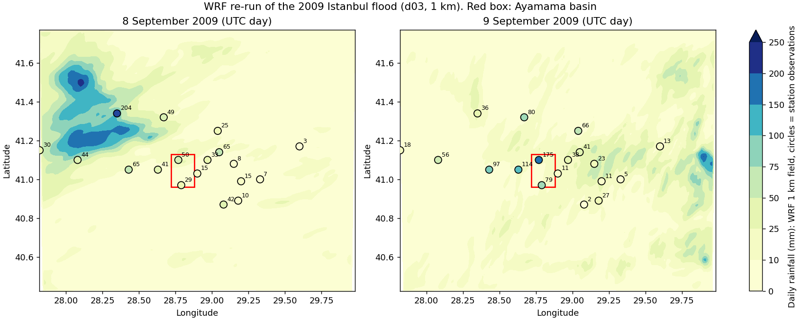

# WRF event re-runs (v0.4, in progress)

**Status (25 Nov 2026):** 2009 run done (results below); October 2026 run under way.

Goal: replace reanalysis rainfall with convection-permitting WRF rainfall for single storms, and pass it through the model's
hydrology and building-level modules. This answers three review points: an atmospheric model coupled to urban hydrology,
testing on more extreme events, and (with `scripts/cordex_change_factors.py`) climate projections from regional models.

## Domains

| Domain | Grid | Size | Area | Convection |
|---|---|---|---|---|
| d01 | 9 km | 121 × 101 | about 1,080 × 900 km, Balkans–western Black Sea | Grell-Freitas (scale-aware) |
| d02 | 3 km | 151 × 121 | Marmara region | Grell-Freitas (scale-aware) |
| d03 | 1 km | 181 × 151 | Istanbul, 180 × 150 km | explicit |
| d04 (optional) | 333 m | 121 × 121 | Ayamama and the western districts, 40 × 40 km | explicit |

Lambert projection centred at 41.10N, 28.90E; 51 levels, top 50 hPa. Physics: Thompson microphysics, RRTMG radiation,
Noah-MP land surface with the single-layer urban canopy model, YSU boundary layer. Boundary data: ERA5, 3-hourly.
d04 is in the boundary-layer grey zone (333 m with a 1-D PBL scheme); use it for sensitivity, not as the reference run.
Rain is also written every 10 minutes on d03/d04 (`rain10min_*` files) for sub-hourly intensities.

## Cases (`events.csv`)

2009 (calibration event), October 2026 (independent test) and four further extreme days chosen from
`outputs/tables/extreme_event_catalogue.csv` (`scripts/extreme_event_catalogue.py`), mixing summer convective and
autumn organised storms on both sides of the Bosphorus. The 8–9 September 2009 storm is not among ERA5's 25 largest
days 1950–2026, although it was the most damaging flood: this is the reason to re-run it with WRF.
Each run starts 12 hours before the first rainfall day (spin-up, excluded from the analysis).

## Steps

On the server (your own account, your own CDS key in `~/.cdsapirc`):

```bash
cd ~/istanbul-flood-cat-model/wrf
python 01_download_era5_for_wrf.py ist2009        # ERA5 GRIB for the case, about 1 GB
bash 02_run_case.sh ist2009                       # WPS + WRF in the background (nohup)
tail -f cases/ist2009/run.log                     # progress; ends with "DONE"
```

Paths default to `~/WPS-4.6.0.11`, the first `~/WRF*/run`, and `WPS_GEOG` beside WPS; override with `WPS_DIR=`,
`WRF_DIR=`, `GEOG=`. `NP=` sets the MPI tasks (default 16). `MAX_DOM=4` adds the 333 m domain.

Copy `cases/<case>/wrf/wrfout_d03_*` back to this repository (same path), then on any machine:

```bash
python wrf/03_wrf_rain_check.py ist2009           # WRF vs stations, 0.25 deg cells, return periods, portfolio loss
python wrf/04_wrf_building_replay.py ist2009      # WRF rainfall -> Ayamama building depths vs observed 2009 depths
```

Outputs go to `outputs/wrf/<case>/`. wrfout files and ERA5 GRIB stay out of git (`.gitignore`).

## What is checked

* Station rainfall: nearest grid point and best point within 10 km (a common allowance for displaced cells).
* Whether WRF puts the 2009 core over Çatalca/Olimpiyat, where ERA5 failed.
* Hourly and 10-minute peaks, which ERA5 cannot give (input for IDF curves and drainage).
* Building depths in Ayamama against the five published 2009 locations (point-wise MAE, as for the station replay).

Next (hydraulics): drive an EPA SWMM model of Ayamama with the 10-minute WRF rainfall, then HEC-RAS 2D.

## First result: 2009



| | Observed (stations) | WRF 1 km |
|---|---|---|
| Çatalca, 8+9 Sep | 240 mm | 124 mm at the grid point, 180 mm within 10 km |
| Olimpiyat, 9 Sep | 175 mm | 9 mm (26 mm within 10 km) |
| Ayamama basin, 8+9 Sep | 107–225 mm at the nearby stations (Florya, Hadımköy, Olimpiyat) | 20 mm basin mean |
| Peak intensities | – | 208 mm/day, 99 mm/h, 30 mm/10 min |

WRF gets the 8 September Çatalca storm (which ERA5 missed) but moves the 9 September convective core away from Ayamama, as earlier NWP studies of this event also found. The rainfall intensity is far better than ERA5; the location is not reliable for a single run. Planned: re-initialisation closer to 9 September and a small physics/initial-time ensemble.
